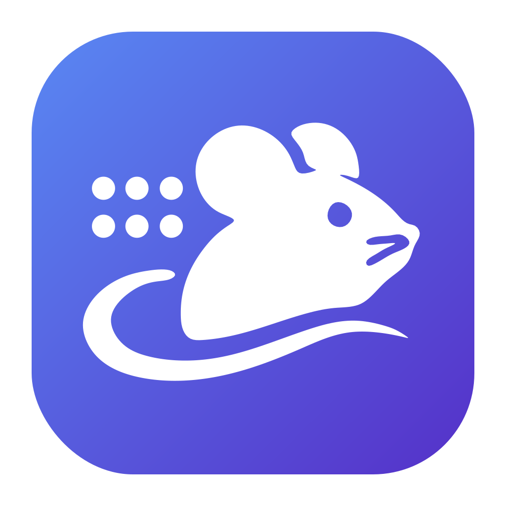

<p align="center">
  
</p>

# tailmouse

Use your iPhone as a trackpad and keyboard for your Mac. It connects over a USB cable, the local network, Tailscale, Bluetooth or Apple's peer-to-peer Wi-Fi (AWDL, the link AirDrop uses). That means it still works on Wi-Fi networks that isolate clients. Both ends are native Swift.

Status: early. v1 covers the trackpad and keyboard.

## How it works

- The Mac runs a menu bar app that listens on one UDP port (47474 by default) and advertises itself with Bonjour.
- The iPhone opens a flow on every route it can find: the USB cable, the local network, Bluetooth and each tailnet address of the Mac, and AWDL when none of those answers. On a 6 GHz Wi-Fi network the Mac switches AWDL off, because it makes every Wi-Fi route stutter there. It probes all of them once a second and sends on the cable when it is plugged in, otherwise on the fastest one that answers.
- Packets are a compact binary layout, 77 bytes for a pointer movement, so the slow Bluetooth link keeps up. The phone and the Mac must run the same build.
- Pointer movement travels as running totals, so a lost packet costs nothing. Clicks and keys are numbered and resent until the Mac acknowledges them, and run once, in order.
- Two-finger scrolls keep gliding after you lift your fingers, like a Mac trackpad. The Mac does the glide, so it costs no extra traffic.
- Drawing mode makes the phone a small drawing tablet: its surface maps to the whole screen, a window or a part of the screen that you choose on the Mac, the way the Screenshot bar chooses what to capture.
- The phone app has three modes: trackpad, trackpad in landscape, and drawing tablet.
- The Mac app has a window (menu bar › Open Tailmouse…) with the device list, scroll momentum, the port, which routes to allow, and Launch at Login. Pairing is under Devices.

Routes in detail, what to expect from Bluetooth, and what to do when the pointer stutters about once a second on Wi-Fi: [DOCUMENTATION.md](DOCUMENTATION.md).

## Security

- Each phone has its own 32-byte key. Every packet is encrypted and authenticated with it (ChaChaPoly). The Mac ignores anything that doesn't open.
- Pairing is a key exchange (X25519). The QR code holds a public key the Mac made for that code; the phone makes a key pair of its own, and both derive the phone's key. A copy of the code does not give that key, even with all the traffic recorded.
- A code pairs one phone, the first to claim it, and only while the pairing window is open. If someone else scans it first, the pairing window closes and your phone does not connect: remove that phone under Devices.
- Removing a phone from the device list deletes its key, so nothing that phone sends opens any more. The other phones stay paired.

## Build

Requires Xcode 27 and [XcodeGen](https://github.com/yonaskolb/XcodeGen) (`brew install xcodegen`).

```sh
cp Config/Local.xcconfig.example Config/Local.xcconfig   # set your team ID
make test         # protocol tests
make run-mac      # build and launch the menu bar app
make install-mac  # or: copy it to /Applications, so Launch at Login works
make ipa          # unsigned build/Tailmouse.ipa, for SideStore
make release      # notarized build/Tailmouse-<version>.zip, for other Macs
```

On first launch, grant Accessibility (the menu offers it), allow incoming connections and, for the Bluetooth route, allow Bluetooth. `make release` needs a paid Apple Developer membership; the one-time setup is at the top of `scripts/release.sh`. To put the iPhone app on your phone, either run the `Tailmouse` scheme from Xcode with your phone selected, or install `build/Tailmouse.ipa` with [SideStore](https://sidestore.io).

## Credits

The pointer model (cumulative totals) and several CGEvent details come from [Entangle](https://github.com/gabrieldonadel/entangle) by Gabriel Donadel (MIT). See [LICENSE](LICENSE).

## License

MIT
